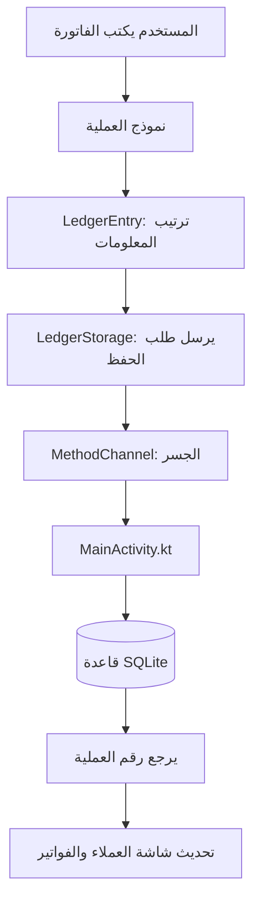

# فاتورة — دليل المشروع والمناقشة

هذا الدليل يشرح تطبيق **فاتورة** بلغة بسيطة. فكرته أن يكون دفتر حسابات صغيرًا في الهاتف: نسجل من اشترى، ماذا اشترى، كم دفع، وهل دفع الآن أم بقي عليه مبلغ.

يمكنك استخدام هذا الملف لتتعرف على المشروع، أو لترتيب شرحك أمام لجنة المناقشة. الشرح هنا يصف الكود الموجود فعلًا، ويذكر بوضوح ما لم يكتمل بعد.

## 1. فكرة التطبيق ببساطة

تخيل أن صاحب محل لديه دفتر ورقي. كل مرة يشتري شخص خبزًا أو أي غرض، يكتب صاحب المحل اسم الشخص والمبلغ. وإذا دفع الشخص جزءًا من المبلغ، تُكتب الدفعة ويقل ما عليه.

تطبيق فاتورة يفعل الفكرة نفسها داخل الهاتف. ويمكن إدخال العملية بطريقتين:

1. **يدويًا:** نكتب اسم العميل والمنتج والمبلغ.
2. **بالصوت:** نتكلم، فيحوّل الهاتف الكلام إلى كتابة، ويجهز التطبيق مسودة نراجعها قبل الحفظ.

لا يحفظ التطبيق الفاتورة الصوتية قبل أن يراجع المستخدم المعلومات ويؤكدها. هذه الخطوة مهمة لأن الهاتف قد يسمع الاسم أو الرقم بطريقة غير صحيحة.

## 2. ما معنى فاتورة ودين ودفعة؟

- **فاتورة مدفوعة:** اشترى العميل ودفع المبلغ كاملًا في اللحظة نفسها. تظهر في المبيعات، لكنها لا تزيد الدين عليه.
- **فاتورة غير مدفوعة:** اشترى العميل وبقي المبلغ عليه.
- **دين قديم:** مبلغ كان على العميل قبل بدء استخدام التطبيق.
- **دفعة:** مبلغ دفعه العميل لتقليل ما عليه.

طريقة حساب الرصيد هي:

```text
رصيد العميل = الفواتير غير المدفوعة + الديون القديمة - الدفعات
```

مثال بسيط: على أحمد فاتورة بـ 20 شيكل، ثم دفع 5 شواكل. يصبح المتبقي عليه 15 شيكل. أما الفاتورة المدفوعة بالكامل فلا تزيد رصيده.

## 3. كيف رُتّب الكود؟

الكود مقسوم إلى أجزاء صغيرة حتى يسهل العثور على كل شيء. داخل كل ميزة توجد ثلاثة مجلدات:

- `data`: معلومات الميزة وقواعدها، مثل أنواع العمليات أو طريقة حساب التقرير.
- `view`: الشاشة الكاملة التي يراها المستخدم.
- `widget`: أجزاء صغيرة من الشاشة يمكن استخدامها داخلها.

مثال: ميزة الفواتير لها مجلد للفلترة، ومجلد لشاشة الفواتير، ومجلد لبطاقة الفاتورة. إذا أردنا تغيير شكل بطاقة واحدة، نعرف أين نبحث.

الأجزاء المشتركة التي تستخدمها أكثر من ميزة موجودة في `lib/core`. مثل زر موحد، حقل موحد، وبطاقة موحدة.

## 4. شكل المجلدات

```text
lib/
  main.dart
  core/
    app_theme.dart
    ledger/
      ledger_entry.dart
      ledger_storage.dart
    utils/
      amount_formatters.dart
    widgets/
      custom_button.dart
      custom_card.dart
      custom_field_block.dart
      custom_screen_header.dart
      custom_text.dart
      custom_text_field.dart
      show_message.dart
  features/
    app_shell/
      data/app_tab.dart
      view/app_shell_view.dart
      widget/app_bottom_bar.dart
    clients/
      data/client_account.dart
      view/clients_view.dart
      widget/client_account_cards.dart
    home/
      data/home_summary.dart
      view/home_view.dart
      widget/home_balance_card.dart
      widget/home_summary_card.dart
      widget/recent_entry_card.dart
      widget/voice_entry_card.dart
    invoices/
      data/invoice_filter.dart
      view/invoices_view.dart
      widget/invoice_entry_widgets.dart
    onboarding/
      data/onboarding_page_data.dart
      view/onboarding_view.dart
      widget/onboarding_artwork.dart
    reports/
      data/sales_report.dart
      view/reports_view.dart
      widget/report_period_and_table.dart
    settings/
      data/settings_section.dart
      view/settings_view.dart
      view/settings_details_view.dart
      widget/settings_option_widgets.dart
    offline_voice_model/
      data/offline_voice_transcriber.dart
      data/voice_model_download_service.dart
      data/voice_model_download_status.dart
      view/offline_voice_model_view.dart
      widget/voice_model_download_card.dart
    transaction_form/
      data/transaction_form_labels.dart
      view/transaction_form_view.dart
      widget/transaction_type_menu.dart
      widget/transaction_type_picker.dart
    voice_capture/
      data/voice_transaction_parser.dart
      view/voice_capture_view.dart
      widget/voice_status_panel.dart
```

قاعدة بيانات أندرويد موجودة هنا:

```text
android/app/src/main/kotlin/com/example/fatora/MainActivity.kt
```

## 5. شرح الملفات ملفًا ملفًا

### ملفات البداية والأجزاء المشتركة

- [main.dart](lib/main.dart): يبدأ التطبيق ويستخدم مظهر الجهاز تلقائيًا، ثم يعرض شاشة الترحيب.
- [app_theme.dart](lib/core/app_theme.dart): يحدد الهوية الليلية والنهارية، وألوانها، وأحجام النصوص، وشكل الحقول والأزرار.
- [ledger_entry.dart](lib/core/ledger/ledger_entry.dart): يصف العملية الواحدة: اسم العميل، المبلغ، نوع العملية، وقتها، والمنتج.
- [ledger_storage.dart](lib/core/ledger/ledger_storage.dart): يطلب قراءة العمليات أو حفظها أو تعديلها أو حذفها. يرسل الطلب إلى كود Kotlin.
- [amount_formatters.dart](lib/core/utils/amount_formatters.dart): يعرض المبالغ والأوقات بشكل مرتب للمستخدم.
- [custom_text.dart](lib/core/widgets/custom_text.dart): نص موحد للتطبيق، حتى يبقى اتجاه الكتابة ومحاذاتها واضحين.
- [custom_text_field.dart](lib/core/widgets/custom_text_field.dart): حقل كتابة موحد. يستخدمه التطبيق لاسم المحل والعميل والمنتج والمبلغ.
- [custom_button.dart](lib/core/widgets/custom_button.dart): زر موحد بعرض وشكل ثابتين.
- [custom_card.dart](lib/core/widgets/custom_card.dart): بطاقة خلفيتها وحدودها موحدتان، لوضع المعلومات داخلها.
- [custom_field_block.dart](lib/core/widgets/custom_field_block.dart): يضع اسم الحقل فوق حقل الكتابة، مثل “اسم العميل”.
- [custom_screen_header.dart](lib/core/widgets/custom_screen_header.dart): عنوان أعلى الشاشة، ومعه زر الرجوع عند الحاجة.
- [show_message.dart](lib/core/widgets/show_message.dart): يعرض رسالة قصيرة أسفل الشاشة، مثل “تم حفظ العملية”.

### ميزة التنقل بين الصفحات

- [app_tab.dart](lib/features/app_shell/data/app_tab.dart): أسماء التبويبات الأربعة: الرئيسية والفواتير والعملاء والإعدادات.
- [app_shell_view.dart](lib/features/app_shell/view/app_shell_view.dart): يجمع الشاشات معًا، ويستقبل طلبات الحفظ والحذف، ثم يحدّث البيانات المعروضة.
- [app_bottom_bar.dart](lib/features/app_shell/widget/app_bottom_bar.dart): شريط التنقل الموجود أسفل التطبيق.

### ميزة العملاء

- [client_account.dart](lib/features/clients/data/client_account.dart): يجمع عمليات الشخص الواحد ويحسب الرصيد المتبقي عليه.
- [clients_view.dart](lib/features/clients/view/clients_view.dart): شاشة البحث عن العملاء، ثم فتح تفاصيل العميل أو حذفه بعد التأكيد.
- [client_account_cards.dart](lib/features/clients/widget/client_account_cards.dart): بطاقات تعرض اسم العميل ورصيده وعملياته.

### ميزة الصفحة الرئيسية

- [home_summary.dart](lib/features/home/data/home_summary.dart): يجهز الأرقام التي تحتاجها الصفحة الرئيسية، مثل مجموع المستحقات ومبيعات اليوم وعدد عمليات اليوم.
- [home_view.dart](lib/features/home/view/home_view.dart): الشاشة الرئيسية وأزرار التسجيل اليدوي والصوتي.
- [home_balance_card.dart](lib/features/home/widget/home_balance_card.dart): بطاقة الرصيد المستحق بتصميم أخضر داكن ولمسة ذهبية.
- [home_summary_card.dart](lib/features/home/widget/home_summary_card.dart): بطاقة رقم واحد، مثل مبيعات اليوم أو عدد العمليات.
- [recent_entry_card.dart](lib/features/home/widget/recent_entry_card.dart): بطاقة عملية حديثة مع نوعها ومبلغها.
- [voice_entry_card.dart](lib/features/home/widget/voice_entry_card.dart): زر التسجيل الصوتي الكبير في الصفحة الرئيسية.

### ميزة الفواتير والعمليات

- [invoice_filter.dart](lib/features/invoices/data/invoice_filter.dart): يحدد العمليات التي تظهر عند اختيار “الكل” أو “المستحقات” أو “الدفعات”.
- [invoices_view.dart](lib/features/invoices/view/invoices_view.dart): شاشة سجل العمليات، ومنها يمكن إضافة عملية أو تعديلها أو حذفها.
- [invoice_entry_widgets.dart](lib/features/invoices/widget/invoice_entry_widgets.dart): بطاقة العملية، وشارة نوعها، ونموذج تعديلها.

### ميزة التعريف بالتطبيق

- [onboarding_page_data.dart](lib/features/onboarding/data/onboarding_page_data.dart): الكلمات والأيقونات التي تظهر في صفحات الترحيب الأولى.
- [onboarding_view.dart](lib/features/onboarding/view/onboarding_view.dart): يعرض صفحات الترحيب وينتقل إلى التطبيق بعدها.
- [onboarding_artwork.dart](lib/features/onboarding/widget/onboarding_artwork.dart): شعار فاتورة والرسومات البسيطة المستخدمة في الترحيب.

### ميزة التقارير

- [sales_report.dart](lib/features/reports/data/sales_report.dart): يختار عمليات اليوم أو الشهر ويحسب صافي المبلغ.
- [reports_view.dart](lib/features/reports/view/reports_view.dart): شاشة كشف العمليات، وتغيير اليوم أو الشهر، واختيار نوع العمليات.
- [report_period_and_table.dart](lib/features/reports/widget/report_period_and_table.dart): أزرار اليوم والشهر وصفوف جدول التقرير.

### ميزة الإعدادات

- [settings_section.dart](lib/features/settings/data/settings_section.dart): أسماء أقسام الإعدادات وعناوينها.
- [settings_view.dart](lib/features/settings/view/settings_view.dart): صفحة الإعدادات الرئيسية.
- [settings_details_view.dart](lib/features/settings/view/settings_details_view.dart): صفحات بيانات المحل والمظهر والتخزين والمساعدة.
- [settings_option_widgets.dart](lib/features/settings/widget/settings_option_widgets.dart): الصفوف والبطاقات الصغيرة التي تظهر في قائمة الإعدادات.

### ميزة إدخال الفاتورة أو الدفعة

- [transaction_form_labels.dart](lib/features/transaction_form/data/transaction_form_labels.dart): يختار عنوان الزر والعنوان المناسب لنوع العملية.
- [transaction_form_view.dart](lib/features/transaction_form/view/transaction_form_view.dart): نموذج كتابة اسم العميل والمنتج والمبلغ، واختيار الدفع الفوري.
- [transaction_type_menu.dart](lib/features/transaction_form/widget/transaction_type_menu.dart): قائمة صغيرة لتغيير نوع العملية أثناء تعبئة النموذج.
- [transaction_type_picker.dart](lib/features/transaction_form/widget/transaction_type_picker.dart): نافذة اختيار فاتورة أو دين قديم أو دفعة.

### ميزة الصوت

- [voice_transaction_parser.dart](lib/features/voice_capture/data/voice_transaction_parser.dart): يبحث في النص عن كلمات بسيطة مثل “دين” و“دفع”، ويقرأ المبلغ من رقم أو كلمة معروفة. بعدها يجهز اسم العميل والمنتج كمسودة.
- [voice_capture_view.dart](lib/features/voice_capture/view/voice_capture_view.dart): يسجل جملة بصيغة WAV، يرسلها للتحويل المحلي، ثم يعرض النص ومسودة العملية للمراجعة.
- [voice_status_panel.dart](lib/features/voice_capture/widget/voice_status_panel.dart): زر الميكروفون وحالة التسجيل أو تحويل الصوت.

### ميزة تنزيل نموذج الصوت

- [voice_model_download_status.dart](lib/features/offline_voice_model/data/voice_model_download_status.dart): يحول حالات أندرويد إلى أسماء بسيطة تستخدمها الشاشة، مثل “ينزّل” و“ينتظر الإنترنت” و“جاهز”.
- [voice_model_download_service.dart](lib/features/offline_voice_model/data/voice_model_download_service.dart): يرسل طلب بدء التنزيل وطلب قراءة التقدم من Flutter إلى Kotlin.
- [offline_voice_model_view.dart](lib/features/offline_voice_model/view/offline_voice_model_view.dart): يقرأ الحالة كل ثانيتين، ويبلغ شاشة التسجيل حين يصبح النموذج جاهزًا.
- [voice_model_download_card.dart](lib/features/offline_voice_model/widget/voice_model_download_card.dart): بطاقة اختيارية فيها الحجم والمساحة المطلوبة والتقدم والانتظار وزر إعادة المحاولة.
- [offline_voice_transcriber.dart](lib/features/offline_voice_model/data/offline_voice_transcriber.dart): يشغل Sherpa-ONNX وQwen3-ASR داخل isolate منفصل حتى لا يتجمد عرض الشاشة أثناء التعرف.
- [VoiceModelDownload.kt](android/app/src/main/kotlin/com/example/fatora/VoiceModelDownload.kt): يستخدم مدير تنزيل Android للتنزيل بالخلفية، ثم يستأنف عند عودة الشبكة. وبعد الاكتمال يجهز ملفات النموذج في مساحة التطبيق باستخدام WorkManager.

اخترنا Qwen3-ASR-0.6B بصيغة int8، ويذكر دليل Sherpa-ONNX أن هذا النموذج يدعم العربية. هذا يعني أنه يستطيع التعرف على العربية، لكنه لا يضمن فهم كل لهجة فلسطينية أو اسم محلي بدقة؛ لذلك تبقى مراجعة النص والفاتورة قبل الحفظ ضرورية. [قائمة اللغات المدعومة](https://github.com/k2-fsa/sherpa/blob/master/docs/source/onnx/qwen3-asr/index.rst).

لا يبدأ تنزيل النموذج تلقائيًا. يختار المستخدم زر التنزيل من **الإعدادات ← التخزين والبيانات** أو من صفحة التسجيل الصوتي. ملف التنزيل يقارب 879 ميغابايت، ويحتاج النموذج بعد فك الضغط نحو 1.9 غيغابايت؛ لذلك تنبّه البطاقة لمساحة التخزين قبل البدء. أثناء التنزيل يظهر التقدم وحالة الاتصال. إذا أُغلق التطبيق يواصل Android التنزيل، وعند فتح التطبيق تُقرأ الحالة المحفوظة. إذا انقطع الإنترنت يتركه مدير التنزيل في حالة انتظار ويحاول الاستكمال عند رجوع الشبكة. وبعد تثبيت النموذج يعمل تحويل الصوت محليًا دون اتصال.

لا يكتفي التطبيق بوجود ملفات النموذج، بل يفحص أن أحجامها قريبة من أحجام نسخة Sherpa الرسمية. إذا توقف التنزيل أو فك الضغط قبل اكتمال ملف كبير، يعرض التطبيق أن النموذج غير جاهز ويطلب تنزيل نسخة كاملة بدل محاولة التعرف بملف ناقص.

الملفان الإضافيان خارج `lib`:

- [widget_test.dart](test/widget_test.dart): ملف اختبار تجريبي جاء مع قالب Flutter القديم. ما زال يبحث عن عدّاد أرقام، لذلك يحتاج تحديثًا قبل أن يمثل اختبارًا صحيحًا لتطبيق “فاتورة”.
- [pubspec.yaml](pubspec.yaml): اسم المشروع وإصداره وحزم Flutter التي يستخدمها.

### ملف Kotlin وقاعدة البيانات

- [MainActivity.kt](android/app/src/main/kotlin/com/example/fatora/MainActivity.kt): يستقبل أوامر Flutter، ثم يقرأ أو يكتب في SQLite.
- جدول `entries`: يحتوي كل فاتورة أو دين أو دفعة، مع اسم العميل والمبلغ والتاريخ والمنتج وحالة الدفع.
- جدول `customers`: يحتفظ بأسماء العملاء المرتبطين بالعمليات.
- جدول `app_settings`: يحتفظ باسم المحل ورقم هاتفه.

## 6. الودجات المستخدمة ولماذا

التطبيق يستخدم ودجات Flutter وMaterial المعروفة. الودجة قطعة جاهزة مثل المكعب: `Text` للكلام، و`FilledButton` للزر، و`Column` لترتيب الأشياء فوق بعضها. نختار القطعة المناسبة ثم نضعها داخل قطعة ثانية لتكوين الشاشة.

### ترتيب الشاشة والعناصر

| الودجت | معناها ببساطة | مثال من التطبيق |
| --- | --- | --- |
| `MaterialApp` | الغلاف العام للتطبيق، وفيه الثيم واللغة والصفحة الأولى | `main.dart` |
| `Scaffold` | هيكل صفحة الهاتف ومكان محتواها | صفحات الإعدادات والتقارير |
| `SafeArea` | يترك مسافة عن النتوء وشريط الحالة | أعلى وأسفل الشاشات |
| `Directionality` | يحدد اتجاه القراءة من اليمين لليسار | التطبيق العربي |
| `Padding` | يضيف مساحة حول عنصر | الهوامش داخل الشاشات |
| `Container` | صندوق نضع فيه محتوى ولونًا وحدودًا | خلفية شريط التبويب |
| `SizedBox` | يحدد مساحة أو فراغًا صغيرًا | المسافات بين العناوين والحقول |
| `Center` | يضع العنصر في منتصف المساحة | رسالة القائمة الفارغة |
| `Align` | يضع العنصر في جهة معينة | محاذاة الأزرار والعناوين |
| `Column` | يرتب العناصر من فوق إلى تحت | حقول النماذج والبطاقات |
| `Row` | يرتب العناصر جنبًا إلى جنب | اسم العميل والمبلغ |
| `Expanded` | يأخذ المساحة الفارغة المتاحة | صفوف البطاقات والقوائم |
| `Spacer` | يضع فراغًا يتمدد بين عنصرين | شريط التنقل وبعض الصفوف |
| `Stack` | يضع عناصر فوق بعضها | رسم شعار التطبيق |
| `Positioned` | يحدد مكان عنصر داخل `Stack` | أجزاء الشعار |
| `ListView` | قائمة طويلة يمكن تمريرها | العملاء والإعدادات والعمليات |
| `SingleChildScrollView` | يسمح بتمرير محتوى صفحة واحدة | صفحة الفواتير والنماذج الطويلة |
| `Divider` | خط رفيع يفصل بين صفين | قائمة الإعدادات وجدول التقرير |
| `AnimatedContainer` | صندوق يتغير شكله بسلاسة | اختيار اليوم أو الشهر في التقرير |
| `Material` | سطح Material يوفّر شكلًا وتأثير لمس | بطاقة العميل وزر الميكروفون |
| `InkWell` | يجعل العنصر يستجيب للمس ويظهر أثر الضغط | بطاقات العملاء وشريط التنقل |
| `GestureDetector` | يلتقط لمسة أو نقرة | اختيار فترة التقرير |

### النصوص والكتابة والأزرار

| الودجت | معناها ببساطة | مثال من التطبيق |
| --- | --- | --- |
| `Text` | يعرض كلمة أو جملة | العناوين والأرصدة |
| `Icon` | يعرض رمزًا صغيرًا | البحث والحذف والميكروفون |
| `TextField` | مكان كتابة بسيط | البحث عن عميل |
| `TextFormField` | مكان كتابة يمكن فحصه قبل الحفظ | اسم العميل والمبلغ |
| `Form` | يجمع حقولًا ويفحصها معًا | نموذج تسجيل العملية |
| `InputDecoration` | يضبط شكل الحقل والنص التلميحي والرمز | حقل المبلغ واسم العميل |
| `FilledButton` | زر رئيسي بلون واضح | حفظ فاتورة أو دفعة |
| `OutlinedButton` | زر بإطار من دون تعبئة قوية | خيارات ثانوية |
| `TextButton` | زر نصي خفيف | إلغاء الحذف أو تأكيده |
| `IconButton` | زر صغير يحمل رمزًا | رجوع أو حذف أو تغيير التاريخ |
| `ChoiceChip` | زر اختيار صغير | فلترة الفواتير والتقرير |
| `Switch.adaptive` | مفتاح تشغيل وإيقاف يتبع شكل الجهاز | تحديد أن الفاتورة مدفوعة الآن |
| `ListTile` | صف جاهز لعنوان ووصف ورمز | عناصر الإعدادات |
| `CircleAvatar` | دائرة تعرض رمزًا أو صورة شخص | صورة رمزية للعميل والمحل |
| `CircularProgressIndicator` | دائرة تدل أن التطبيق يعمل | أثناء انتظار نتيجة |

### النوافذ والتنقل

| الودجت أو الأداة | معناها ببساطة | مثال من التطبيق |
| --- | --- | --- |
| `AlertDialog` | نافذة تسأل قبل تنفيذ شيء مهم | تأكيد حذف عميل أو عملية |
| `showModalBottomSheet` | يفتح قائمة من أسفل الشاشة | اختيار نوع العملية |
| `Navigator` | يفتح شاشة ويرجع منها | نموذج الفاتورة وتفاصيل العميل |
| `Theme` | يعطي الودجات ألوان وخطوط التطبيق | الوضع الفاتح والداكن |
| `MethodChannel` | جسر يرسل رسالة من Dart إلى Kotlin | حفظ وقراءة قاعدة بيانات الهاتف |

ليست كل كلمة في الجدول “ودجة” بالمعنى الدقيق: `Navigator` و`Theme` و`MethodChannel` أدوات للتنقل والمظهر والاتصال. وضعناها هنا حتى تجد شرحًا للأشياء التي ستراها في الملفات.

### الودجات التي صممناها للمشروع

هذه أسماء قطع صنعناها في المشروع كي نستخدم شكلًا واحدًا في صفحات متعددة:

| اسم القطعة | ماذا تعرض؟ | ملفها |
| --- | --- | --- |
| `CustomText` | نصًا بمحاذاة واتجاه موحدين | `lib/core/widgets/custom_text.dart` |
| `CustomTextField` | حقل كتابة موحدًا للنصوص والأرقام | `lib/core/widgets/custom_text_field.dart` |
| `CustomButton` | زرًا رئيسيًا موحد الشكل | `lib/core/widgets/custom_button.dart` |
| `CustomCard` | بطاقة بخلفية وحدود موحدة | `lib/core/widgets/custom_card.dart` |
| `CustomFieldBlock` | عنوانًا فوق حقل الكتابة | `lib/core/widgets/custom_field_block.dart` |
| `CustomScreenHeader` | عنوان الصفحة وزر الرجوع | `lib/core/widgets/custom_screen_header.dart` |
| `AppBottomBar` | أزرار الانتقال بين الصفحات الأربع | `lib/features/app_shell/widget/app_bottom_bar.dart` |
| `HomeBalanceCard` | الرصيد المستحق بتصميم بارز | `lib/features/home/widget/home_balance_card.dart` |
| `HomeSummaryCard` | رقمًا مختصرًا مثل مبيعات اليوم | `lib/features/home/widget/home_summary_card.dart` |
| `RecentEntryCard` | عملية حديثة في الصفحة الرئيسية | `lib/features/home/widget/recent_entry_card.dart` |
| `VoiceEntryCard` | زر التسجيل الصوتي في الصفحة الرئيسية | `lib/features/home/widget/voice_entry_card.dart` |
| `ClientCard` | اسم العميل ورصيده | `lib/features/clients/widget/client_account_cards.dart` |
| `ClientEntryCard` | عملية واحدة في حساب العميل | `lib/features/clients/widget/client_account_cards.dart` |
| `InvoiceCard` | فاتورة أو دين مع أزرارها | `lib/features/invoices/widget/invoice_entry_widgets.dart` |
| `ReportPeriodSelector` | اختيار تقرير اليوم أو الشهر | `lib/features/reports/widget/report_period_and_table.dart` |
| `ReportTableRow` | صف واحد في كشف المبيعات | `lib/features/reports/widget/report_period_and_table.dart` |
| `SettingRow` | صف واحد من خيارات الإعدادات | `lib/features/settings/widget/settings_option_widgets.dart` |
| `VoiceStatusPanel` | زر الميكروفون وحالة الاستماع | `lib/features/voice_capture/widget/voice_status_panel.dart` |
| `VoiceModelDownloadCard` | بدء تنزيل النموذج ومتابعة حالته ومساحته | `lib/features/offline_voice_model/widget/voice_model_download_card.dart` |
| `showMessage` | رسالة قصيرة بعد الحفظ أو عند الخطأ | `lib/core/widgets/show_message.dart` |
| `FatoraLogo` | شعار التطبيق في شاشة الترحيب | `lib/features/onboarding/widget/onboarding_artwork.dart` |
| `LogoBar` | عمود صغير يرسم جزءًا من الشعار | الملف نفسه |
| `IntroIllustration` | رسمة بسيطة لصفحة من صفحات الترحيب | الملف نفسه |
| `TransactionTypeMenu` | قائمة أنواع العملية داخل النموذج | `lib/features/transaction_form/widget/transaction_type_menu.dart` |
| `_TransactionTypeChoice` | صف اختيار فاتورة أو دين أو دفعة | `lib/features/transaction_form/widget/transaction_type_picker.dart` |
| `SettingsCard` | مجموعة إعدادات داخل بطاقة | `lib/features/settings/widget/settings_option_widgets.dart` |
| `ThemeChoice` | اختيار الوضع الفاتح أو الداكن أو حسب الجهاز | الملف نفسه |
| `_EntryTypeBadge` | شارة صغيرة توضح نوع الفاتورة | `lib/features/invoices/widget/invoice_entry_widgets.dart` |
| `_EditEntrySheet` | نموذج تعديل عملية من أسفل الشاشة | الملف نفسه |
| `_PeriodButton` | زر اختيار اليوم أو الشهر | `lib/features/reports/widget/report_period_and_table.dart` |
| `_StorageCount` | مربع يعرض عدد العملاء أو العمليات | `lib/features/settings/view/settings_details_view.dart` |

### قواعد المظهر والقراءة

- الوضع الافتراضي يتبع إعدادات ألوان الهاتف، ويمكن تغييره من الإعدادات إلى الفاتح أو الداكن.
- الوضع الفاتح يستخدم خلفية بلون الورق وبطاقات عاجية، والوضع الداكن يستخدم خلفيات خضراء فحمية. الأخضر هو لون الأزرار، والذهبي للتأكيد وإبراز الرصيد.
- النص العربي يستخدم خط النظام، لذلك يظهر بخط الهاتف المعتاد دون تنزيل ملفات خطوط إضافية.
- حجم النص الثانوي لا يقل عن 12، وأسماء الشاشات والأرقام المهمة أكبر منه. لا نوقف تكبير النص من إعدادات سهولة الاستخدام.
- الأزرار الأساسية لا يقل ارتفاعها عن 52، وعناصر التنقل مصممة لتُلمس بسهولة.

والشاشات نفسها عبارة عن ودجات كبيرة تجمع القطع الأصغر:

| اسم الشاشة | مهمتها | ملفها |
| --- | --- | --- |
| `MyApp` | يجهز الثيم وصفحة البداية | `lib/main.dart` |
| `OnboardingScreen` | يعرّف المستخدم بالتطبيق عند فتحه | `lib/features/onboarding/view/onboarding_view.dart` |
| `AppShell` | يحمل البيانات ويبدل بين التبويبات | `lib/features/app_shell/view/app_shell_view.dart` |
| `HomeScreen` | يعرض ملخص الحساب وآخر العمليات | `lib/features/home/view/home_view.dart` |
| `InvoicesScreen` | يعرض الفواتير والديون والدفعات | `lib/features/invoices/view/invoices_view.dart` |
| `ClientsScreen` | يبحث في العملاء ويفتح حساب العميل | `lib/features/clients/view/clients_view.dart` |
| `ClientDetailsScreen` | يعرض الرصيد وعمليات عميل واحد | الملف نفسه |
| `ReportsScreen` | يعرض كشف اليوم أو الشهر | `lib/features/reports/view/reports_view.dart` |
| `SettingsScreen` | يعرض قائمة الإعدادات | `lib/features/settings/view/settings_view.dart` |
| `SettingsDetailsScreen` | يعرض تفاصيل خيار من الإعدادات | `lib/features/settings/view/settings_details_view.dart` |
| `TransactionFormScreen` | يستقبل بيانات فاتورة أو دين أو دفعة | `lib/features/transaction_form/view/transaction_form_view.dart` |
| `VoiceCaptureScreen` | يسجل الصوت محليًا ويجهز مسودة للمراجعة | `lib/features/voice_capture/view/voice_capture_view.dart` |
| `OfflineVoiceModelView` | يقرأ حالة تنزيل النموذج ويحدث بطاقة التنزيل | `lib/features/offline_voice_model/view/offline_voice_model_view.dart` |

إذا أردنا تغيير لون كل الأزرار الرئيسية، نعدل `CustomButton` مرة واحدة. وإذا أردنا تغيير شكل بطاقة العميل فقط، نعدل `ClientCard` في مجلد العملاء.

في شاشة تفاصيل الإعدادات توجد صفحات صغيرة خاصة بكل خيار: `_AccountPage` لبيانات المحل، و`_AppearancePage` للألوان، و`_StoragePage` للتخزين. وتوجد أيضًا `_BackupPage` و`_ListsPage` و`_LanguagePage` و`_PrivacyPage` و`_NotificationsPage` و`_HelpPage`. أسماؤها تبدأ بشرطة سفلية لأنها أجزاء داخلية تستخدمها شاشة الإعدادات نفسها.

## 7. كيف تتصل أجزاء التطبيق ببعضها؟

### مثال تسجيل فاتورة يدويًا

1. يضغط المستخدم زر الإضافة في الصفحة الرئيسية.
2. يفتح `transaction_type_picker.dart` ويختار “تسجيل فاتورة”.
3. تفتح `transaction_form_view.dart` وتظهر حقول العميل والمنتج والمبلغ.
4. عند الضغط على حفظ، ترجع الشاشة كائن `LedgerEntry` فيه معلومات الفاتورة.
5. يستقبل `app_shell_view.dart` هذه المعلومات ويرسلها إلى `LedgerStorage`.
6. يرسل `LedgerStorage` رسالة اسمها `addEntry` عبر `MethodChannel`.
7. يستقبل `MainActivity.kt` الرسالة ويحفظ الفاتورة في SQLite.
8. يرجع رقم العملية إلى Flutter، فتتحدث قائمة الفواتير ورصيد العميل.

الرسم التالي يوضح الطريق باختصار:



### مثال التسجيل بالصوت

1. يضغط المستخدم زر الميكروفون.
2. يسجل التطبيق الصوت بصيغة WAV mono وبمعدل 16 kHz، وهو الشكل الذي يستقبله نموذج التعرف.
3. يحول Sherpa-ONNX الصوت المسجل إلى نص باستخدام نموذج Qwen3-ASR المثبت محليًا.
4. `VoiceTransactionParser` يبحث في الكلمات عن اسم ومبلغ وكلمات مثل “دين” أو “دفع”.
5. يملأ التطبيق نموذج الفاتورة بما استطاع معرفته.
6. يراجع المستخدم الكلام والحقول، ويصحح أي خطأ.
7. عند التأكيد، تستخدم الفاتورة طريق الحفظ نفسه المستخدم في الإدخال اليدوي.

التطبيق لا يفهم كل جملة مثل الإنسان؛ هو يبحث عن كلمات معروفة مثل “اشترى” و“دين” و“دفع”، ويحاول قراءة رقم أو مبلغ شائع مثل “عشرة”. لذلك قد يخطئ مع بعض الجمل أو الأسماء. يراجع المستخدم المسودة قبل حفظها.

## 8. كيف نستخدم ملفًا من ملف آخر؟

تظهر الاستيرادات أعلى ملفات Dart. مثلًا:

```dart
import 'package:fatora/core/widgets/custom_button.dart';
```

هذا السطر معناه: “أريد استخدام الزر الموجود في مجلد الأدوات المشتركة”. اسم `fatora` مأخوذ من `name` في `pubspec.yaml`. استخدام هذا الشكل يجعل مكان الملف واضحًا، بدل حساب عدد المجلدات للخلف.

تأخذ الشاشة ودجت من ملف آخر وتضعها داخلها. مثلًا `transaction_form_view.dart` يستورد `CustomTextField` ثم يضعه داخل `CustomFieldBlock`.

## 9. شرح بعض أسماء الدوال

- `loadEntries`: اقرأ العمليات المحفوظة.
- `addEntry`: أضف عملية جديدة.
- `updateEntry`: احفظ التغييرات على عملية.
- `deleteEntry`: احذف عملية.
- `deleteCustomer`: احذف العميل وعملياته.
- `makeDraftFromWords`: جهز مسودة من الكلمات التي سمعها الهاتف.
- `findAmount`: ابحث عن المبلغ في الجملة.
- `saveShopProfile`: احفظ اسم المحل ورقم الهاتف.
- `showTransactionTypePicker`: افتح قائمة اختيار نوع العملية.
- `showMessage`: اعرض رسالة قصيرة.

استخدمنا أسماء تصف ما تفعله الدالة. عندما تقرأ `deleteCustomer`، تفهم من الاسم أنها تحذف عميلًا.

## 10. كلمات بسيطة قد تظهر في المناقشة

- **Widget:** قطعة واجهة، مثل زر أو نص أو بطاقة.
- **Feature:** مجموعة الملفات التي تنفذ جزءًا واحدًا، مثل العملاء.
- **Data:** معلومات وقواعد خاصة بالميزة.
- **View:** الشاشة الكاملة التي يراها المستخدم.
- **Repository / Storage:** المكان الذي تطلب منه الشاشة قراءة البيانات أو حفظها.
- **SQLite:** دفتر جداول صغير محفوظ داخل الهاتف.
- **MethodChannel:** جسر يرسل رسالة بين Flutter وKotlin.
- **Validation:** فحص المدخلات قبل الحفظ، مثل رفض مبلغ فارغ أو صفر.

الفكرة ليست أن نحفظ الكلمات الصعبة؛ يكفي شرحها بأمثلة من التطبيق.

## 11. أسئلة متوقعة في المناقشة

**ما المشكلة التي يحلها المشروع؟**  
يساعد صاحب المحل على حفظ عمليات البيع والديون والدفعات بطريقة منظمة، بدل الاعتماد الكامل على الدفتر الورقي.

**من المستخدم المقصود؟**  
أصحاب المحلات الصغيرة، ومن يفضّل خطوات قصيرة وواضحة أو إدخال العملية بالصوت.

**لماذا يوجد إدخال صوتي؟**  
حتى يستطيع المستخدم قول جملة قصيرة بدل كتابة كل البيانات. يعرض التطبيق مسودة للمراجعة لتقليل أخطاء التعرف على الكلام.

**هل كل فاتورة تعتبر دينًا؟**  
لا. يحدد المستخدم إن كانت مدفوعة الآن. الفاتورة المدفوعة تدخل في المبيعات ولا ترفع دين العميل.

**كيف يخفض التطبيق الدين؟**  
يسجل المستخدم دفعة باسم العميل، ثم يطرح التطبيق مبلغها من رصيده.

**أين تحفظ البيانات؟**  
في SQLite على هاتف Android، وتُستخدم قاعدة البيانات عبر كود Kotlin.

**هل يعمل دون إنترنت؟**  
تسجيل العمليات وقراءتها محليًا يعملان دون إنترنت. تنزيل نموذج الصوت يحتاج اتصالًا مرة واحدة فقط. بعد اكتمال التنزيل والتجهيز، يحول التطبيق التسجيل إلى نص على الجهاز دون إرسال الصوت إلى خدمة خارجية.

**كيف قسمت ملفات التطبيق؟**  
كل ميزة لها `data` للمعلومات، و`view` للشاشة، و`widget` للأجزاء الصغيرة. الأجزاء المشتركة مثل الزر والحقل موجودة في `core/widgets`.

**ما حدود النسخة الحالية؟**  
لا توجد مزامنة مع خادم. النسخ الاحتياطي والاستعادة وتصدير PDF والإشعارات لم تكتمل بعد. يجب ذكر ذلك بوضوح في المناقشة.

## 12. خطوات عرض المشروع

1. افتح التطبيق واعرض صفحة الترحيب ثم الصفحة الرئيسية.
2. أضف عميلًا وسجل له فاتورة غير مدفوعة.
3. سجل دفعة أصغر من قيمة الفاتورة، ثم اعرض الرصيد الجديد.
4. سجل فاتورة أخرى مدفوعة فورًا، واشرح أنها لا تزيد الدين.
5. اعرض سجل العميل وسجل العمليات.
6. إذا كان النموذج مثبتًا، جرّب التسجيل الصوتي وبيّن خطوة مراجعة المسودة. وإذا لم يكن مثبتًا، اعرض خيار تنزيله وحالة التنزيل الاختيارية.
7. افتح التقرير واشرح الفلاتر والحساب.
8. افتح الإعدادات وبيّن أن اسم المحل محفوظ محليًا.

## 13. تشغيل المشروع

يحتاج المشروع إلى Flutter وJDK 17 وAndroid SDK. من مجلد المشروع شغّل:

```powershell
flutter pub get
flutter analyze
flutter build apk --debug --target-platform android-arm64
```

يوضع APK التجريبي في:

```text
build/app/outputs/flutter-apk/app-debug.apk
```

## 14. حزم Android المحلية

يستخدم المشروع SDK 36 الموجود في جهاز التطوير. الملف `android/build.gradle.kts` يضبط مكتبات Android على SDK 36 قبل أن يبدأ Gradle بإنشاء نسخها. هذا إعداد للبناء فقط، ولا يغيّر طريقة عمل التطبيق.

توجد نسخ محلية من بعض الحزم داخل `packages`:

- `sherpa_onnx_android_only`: نسخة Sherpa ONNX رقم 2.0.2. أبقينا ربط Android والويب، وأزلنا ربط iOS وLinux وmacOS وWindows حتى لا يحتاج بناء Android إلى تنزيل ملفاتها الكبيرة.
- `jni_sdk36` و`jni_flutter_sdk36`: نسختان من JNI رقم 1.2.1 وJNI Flutter رقم 1.1.0. ملفات Android فيهما تستخدم SDK 36، وهو الموجود على الجهاز.

تحتفظ هذه النسخ بملفات الترخيص والمصدر الأصلي اللازم للتشغيل. عند تحديث أي حزمة منها، قارن التغييرات مع النسخة الجديدة قبل نقلها إلى `packages`.
